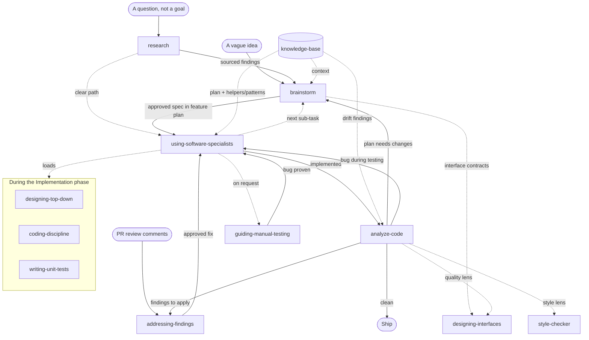

# coding-skills

Claude Code skills for software development. They give the agent a fixed
method for each part of the work: scoping a feature, designing its
interfaces, writing and testing the code, and reviewing the result.

A skill is a directory with a `SKILL.md` file. Claude Code loads a skill when
your request matches the skill's description, or when you call it by name as
a slash command.

## Skills

| Skill | What it does |
|-------|--------------|
| [addressing-findings](addressing-findings/) | Works through an `analyze-code` report or the review comments on a pull request, one finding at a time. For each finding it explains the problem, recommends a fix and waits for your approval. It never posts to the pull request. It gives you the reply text instead. |
| [analyze-code](analyze-code/) | Reviews existing code through five lenses: architecture, quality, performance, security and style. An independent check confirms or rejects each finding before it goes into a report ranked by severity. It reports only and never changes the code. |
| [brainstorm](brainstorm/) | Turns a vague idea into an approved spec through questions, asked one at a time. It splits every feature into small sub-tasks, saves them in a feature plan and designs one sub-task at a time. It writes no code. |
| [coding-discipline](coding-discipline/) | Names six common failure modes of code written by language models, such as silent assumptions and scope creep, and gives the counter for each. |
| [designing-interfaces](designing-interfaces/) | Requires a written contract for each new or changed interface before the code exists. The contract states what the code does, where it lives, its signature and how a caller uses it. A design that pushes work onto its callers is sent back. |
| [designing-top-down](designing-top-down/) | Sets the order in which code is written. The top function comes first, as real code that calls stubs for the unsolved steps. Each stub is then written in turn, until no unsolved step is left. |
| [guiding-manual-testing](guiding-manual-testing/) | Guides you through testing a change by hand with real data on a local, testing or staging environment. It proposes one step at a time, and you run it and paste the output back. It never runs anything itself. |
| [knowledge-base](knowledge-base/) | Maintains a project knowledge base: a wiki of each repository's system surfaces, implementation plans, and plain-language manuals for operators. The other skills read it when `kb_path` is configured. |
| [research](research/) | Answers questions about your own codebase, such as "do we have an endpoint for X?", by reading the code and the knowledge base. Every answer cites its source. |
| [style-checker](style-checker/) | Checks code against Google's style guides for formatting and naming, and reports the violations by severity. It supports 13 languages, including Go, Java, Python, TypeScript and Shell. |
| [using-software-specialists](using-software-specialists/) | Routes a software task to the specialists it needs, such as a security engineer, an architect or a tester, at each phase of the work. Every task ends with a checklist of security and quality questions that must be answered before the task is done. |
| [writing-unit-tests](writing-unit-tests/) | Guides you in writing unit tests in any language. It lists the test cases before it writes them and includes references for Go, Java, JavaScript and Python. |

## Requirements

- [Claude Code](https://claude.com/claude-code).
- Optional: the [serena](https://github.com/oraios/serena) MCP server. `research`
  uses it to read single symbols instead of whole files. Without it,
  `research` falls back to search and file reads.

## Installation

Copy the skill directories into your Claude Code skills folder. Several skills
load other skills, for example `analyze-code` loads `style-checker` and
`designing-interfaces`, so install all of them unless you have a reason not to:

```bash
cp -r addressing-findings analyze-code brainstorm coding-discipline \
  designing-interfaces designing-top-down guiding-manual-testing \
  knowledge-base research style-checker using-software-specialists \
  writing-unit-tests ~/.claude/skills/
```

## Configuration

Only `knowledge-base` needs configuration. Add `kb_path`, the absolute path of
the knowledge base, to your agent instructions:

```yaml
kb_path: /Users/you/.kb/work
```

Without `kb_path`, `knowledge-base` refuses to run, and `brainstorm` saves its
plans in `docs/specs/`, or wherever the project already keeps them.

## Usage

Call a skill by its slash command and describe the task after it:

```
/brainstorm I want to build a rate limiter for our API
/using-software-specialists add OAuth support to the backend
/analyze-code review the auth module
/research do we have an endpoint for password reset, and what is its payload?
```

Each skill's own `README.md` has more examples.

## How the skills work together

A feature usually goes through four skills in order:

1. `/brainstorm` agrees the scope with you and splits the feature into
   sub-tasks. It saves a feature plan in `<kb_path>/plans/`, or in
   `docs/specs/` when no `kb_path` is configured. It then designs one
   sub-task at a time and saves each approved spec in the feature plan. In a
   new session, `/brainstorm continue <feature>` resumes from the plan.
2. `/using-software-specialists` implements the sub-task that is in progress,
   from its saved spec. It loads `designing-top-down` and `coding-discipline`
   while it writes the code, and `writing-unit-tests` when the code works.
3. `/analyze-code` reviews the result. The report ends with suggested next
   actions that send each group of findings to the specialist who should fix
   it.
4. `/addressing-findings` applies the fixes you approve, one finding at a time.

If the review shows that the plan must change, run `/brainstorm` on the
existing plan file. It asks only about the parts that change and updates the
plan in place. If testing finds a bug, run `/using-software-specialists`
again, starting with the troubleshooter specialist.

The other skills come in at specific points:

- `/research` answers questions about the code at any time. Its answers can
  settle questions that `brainstorm` would otherwise ask you.
- `/guiding-manual-testing` checks a change against real data before you merge
  or release it. A failed check goes back into the loop like a review finding.
- `designing-interfaces` checks each interface that `brainstorm` proposes, and
  `analyze-code` uses it again in its quality lens.
- `style-checker` runs on its own, or as the style lens of `analyze-code`.
- `knowledge-base` gives the other skills shared context when `kb_path` is
  configured. `brainstorm` reads the wiki and writes the plans,
  `using-software-specialists` reads the plan and the repository's helpers and
  patterns, and `analyze-code` reports places where the wiki and the code
  disagree.



## License

MIT. See [LICENSE](LICENSE).
